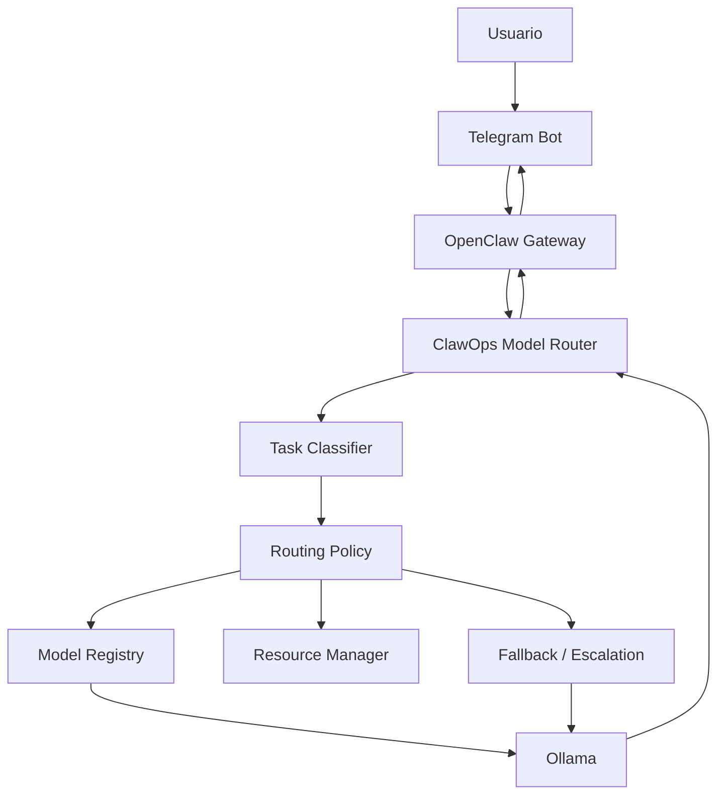

# Arquitectura de ClawOps

## 1. Objetivo

ClawOps es un laboratorio local-first para estudiar agentes y routing de modelos. El sistema inicial conecta Telegram con OpenClaw, y OpenClaw con un servicio independiente de selección de modelos que utiliza Ollama.

## 2. Diagrama lógico

## 3. Responsabilidades

### Telegram
Canal de entrada y salida. El bot se crea mediante BotFather. El token se trata como secreto. Telegram no contiene lógica de routing.

### OpenClaw
Gateway y runtime del agente. Administra el canal, sesiones, contexto, configuración del agente y uso de herramientas. No debe duplicar las políticas de selección que pertenecen al Model Router.

La integración con un endpoint OpenAI-compatible es una hipótesis de integración que debe validarse en un spike. Verificar como mínimo:
- descubrimiento/listado de modelos;
- formato de chat completions;
- streaming;
- tool/function calls;
- manejo de errores y timeouts;
- propagación del contexto y mensajes de sistema.

No asumir que una compatibilidad parcial es suficiente para producción.

### ClawOps Model Router
Servicio independiente en Python/FastAPI. Recibe solicitudes de inferencia, clasifica o estima la tarea, selecciona un perfil/modelo, aplica restricciones de recursos, invoca el proveedor y devuelve una respuesta compatible con el contrato acordado.

Responsabilidades:
- clasificación de tareas;
- evaluación de complejidad;
- políticas de routing;
- registro de modelos y capacidades;
- selección basada en recursos;
- fallback y escalamiento;
- telemetría de decisiones.

### Ollama
Runtime local de inferencia. El Router lo consume mediante un adaptador. El Router no debe depender de detalles específicos de Ollama fuera de ese adaptador.

### Docker Compose
Orquesta los componentes locales. Los modelos pueden ejecutarse en el host mediante Ollama o en un contenedor, según la compatibilidad de GPU y red que se valide en el entorno de desarrollo.

### Floci AZ
Emula localmente determinadas APIs de Azure para pruebas. No se debe asumir paridad total ni utilizarlo como prueba de comportamiento real de Azure.

## 4. Límites del MVP

Incluido:
- conversación por Telegram;
- OpenClaw;
- servicio Router separado;
- Ollama;
- perfiles de routing configurables;
- reglas determinísticas iniciales;
- registro básico de decisiones;
- fallback acotado;
- ejecución local mediante Docker Compose.

Fuera del MVP:
- despliegue productivo;
- recursos Azure reales;
- agentes múltiples;
- RAG;
- MCP;
- base de datos dedicada;
- dashboard;
- automatizaciones con efectos externos;
- routing basado en un LLM como primera estrategia.

## 5. Evolución cloud

Cuando el MVP local esté validado, se evaluará:
- Azure Container Apps para hospedar servicios;
- Azure Container Registry para imágenes;
- Azure Key Vault para secretos;
- Azure Files para estado persistente cuando sea necesario;
- Managed Identity y RBAC;
- Bicep como infraestructura como código.

La inferencia local no debe trasladarse automáticamente a Azure. La arquitectura cloud deberá decidir explícitamente dónde reside Ollama y cómo se alcanza de forma segura.
